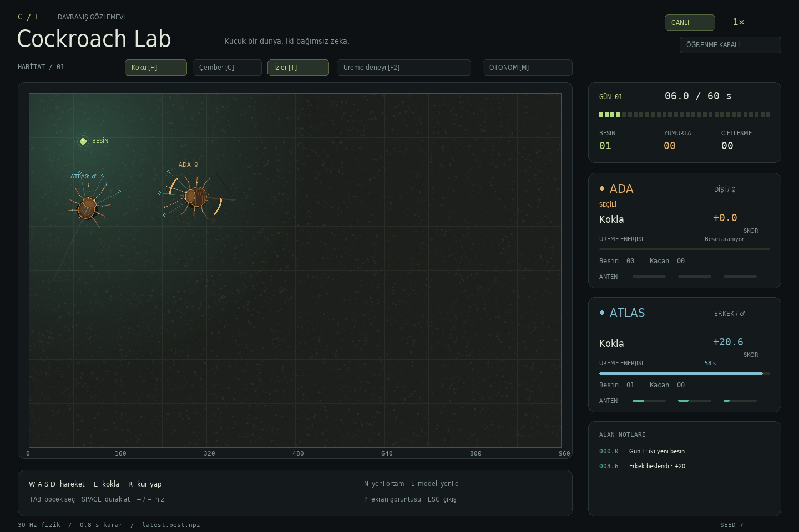
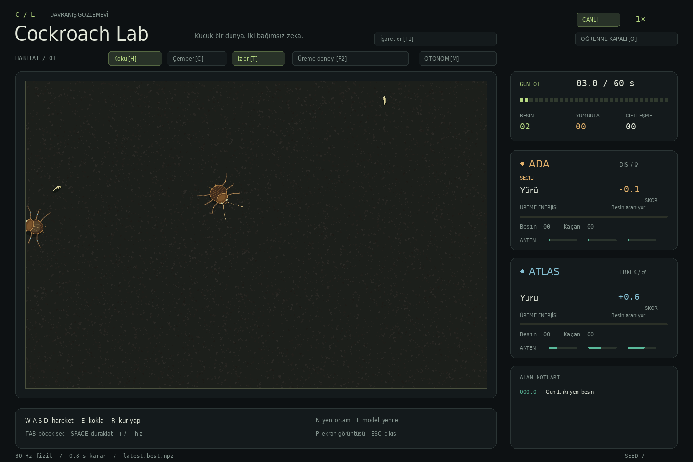

# Cockroach Lab

**İki böcek, iki bağımsız öğrenen beyin, tek akvaryum.**

Tepeden görülen 2D bir böcek yaşam alanı ve küçük bir pekiştirmeli öğrenme laboratuvarı.
Penceresiz eğitim gerçek zamandan çok daha hızlı çalışır. Gözlemevi aynı fiziği kullanır,
varsayılan olarak öğrenmeden davranışları gösterir ve elle kontrol sunar. İsteğe bağlı
canlı öğrenme tek düğmeyle açılabilir.



## Hızlı başlangıç

Python **3.10 veya üzeri** yeterli. GPU, PyTorch, ROS veya harici görsel dosyası gerekmez.
Linux/macOS üzerinde:

```bash
./setup.sh
./view.sh
```

Görüntüleyici sırasıyla `runs/latest.best.npz`, `runs/latest.npz` ve depoya eklenmiş
`examples/forager.npz` modelini arar. Hiçbiri yoksa rastgele davranışla başlar.

```bash
./train.sh 5                         # 5 gerçek dakika, pencere açmadan öğren
./view.sh                            # izle; varsayılan olarak öğrenme kapalı
./view.sh --random                   # eğitimsiz başlangıçla karşılaştır
./view.sh --model examples/forager.npz
./view.sh --natural                  # işaretler olmadan doğal habitat
./view.sh --learn                    # canlı öğrenmeyi açık başlat
```

Betik kullanmadan, Windows dahil:

```bash
python -m venv .venv
# Linux/macOS: source .venv/bin/activate
# Windows PowerShell: .venv\Scripts\Activate.ps1
python -m pip install -e ".[viewer,dev]"
cockroach train --minutes 5
cockroach view
```

Yalnızca uzak bir makinede eğitim için `pip install -e .` yeterli; pygame kurulmaz,
ekran sunucusu aranmaz. Python modülüyle de çalışır: `python -m cockroach train --minutes 5`.

## Gözlemevi

| Kontrol | İşlev |
| --- | --- |
| Böceğe tıkla / `Tab` | Ada (dişi) veya Atlas (erkek) seç |
| `M` | Seçili böceğin elle/otonom kontrolünü değiştir |
| `W A S D` / yön tuşları | İleri, sola dön, geri, sağa dön |
| `E` | Kokla |
| `R` | Kur yap; yakın ve beslenmiş eşe abdomenini yöneltip geri yaklaş |
| `Space` | Duraklat / devam et |
| `H` | Koku alanını göster/gizle |
| `C` | Çarpışma çemberlerini ve abdomen temas noktalarını göster/gizle |
| `T` | Hareket izlerini göster/gizle |
| `F1` / İşaretler düğmesi | Habitatın tüm yardımcı çizimlerini birlikte göster/gizle |
| `O` / Öğrenme düğmesi | Canlı öğrenmeyi aç/kapat; varsayılan kapalı |
| `+` / `-` | Gözlem hızı: 0,5×, 1×, 2×, 4×, 8× |
| `F2` | Beslenmiş çiftle etiketli üreme deneyi başlat |
| `N` | Yeni rastgele ortam |
| `L` | Açık model dosyasının son kaydını yükle ve yeni bölüm başlat |
| `P` | `runs/screenshots/` içine PNG kaydet |
| `Esc` | Çık |

Eylemler 24 fizik karesi, yani **0,8 saniye** sürer. Elle verilen eylem de bir sonraki
karar sınırında uygulanır. Tek karelik ileri/geri titreşimi oluşmaz. Diğer böcek otonom
kalmaya devam eder. Pencere yeniden boyutlandırılabilir.

`F2`, çiftleşme fiziğini incelemek için iki böceği beslenmiş olarak yan yana koyar ve
kur eylemini seçer. Bu bir **deney sahnesidir**, öğrenilmiş bir başarı olarak sayılmaz;
eğitime veya değerlendirmeye dahil edilmez. Sonrasında `N` ile normal ortama dönülür.

`F1` kapalıyken habitatta yalnızca böcekler, hareketli kurtçuklar ve yumurtalar görünür;
adlar, seçim yayları, koklama çizgileri, besin etiketleri, koku alanı, izler, çarpışma
çemberleri ve koordinat ızgarası gizlenir. Yan bilgi panelleri ve kontrol düğmeleri
kullanılabilir kalır. Ayrı koku/iz/çember tercihleri korunur; `F1` tekrar açıldığında geri gelir.



## Canlı öğrenme

Bu küçük NumPy ağlarında gerçek zamanlı öğrenmenin hesap yükü düşüktür: her 0,8 saniyede
iki deney kaydedilir ve yeterli replay birikince her dört kararda bir küçük ağ güncellenir.
Penceresiz eğitimle aynı öğrenme yöntemidir; gözlem hızında ilerlediği için daha yavaştır.
`O` ile açılana veya `--learn` verilene kadar öğrenme yapılmaz.

```bash
./view.sh --learn --model runs/latest.npz
./view.sh --learn --model runs/live.npz       # canlı öğrenmenin kaydından devam
./view.sh --learn --output runs/my-live.npz
```

Canlı mod mevcut ağırlıkları, optimizer durumunu ve keşif sayacını korur. Replay ilk
açılışta boştur; 256 geçiş birikince ağırlık güncellemeleri başlar. Aynı pencere içinde
öğrenmeyi kapatıp açmak replay'i silmez. Elle kontrol sırasında ve `F2` ile başlatılan
deney dünyasının tamamında öğrenme askıya alınır; normal ortama `N` ile dönülür.
Duraklatıldığında da öğrenme ilerlemez.

Canlı öğrenme 15 saniyede bir, kapatıldığında ve pencere kapanırken **`runs/live.npz`**
dosyasına kaydedilir; açılan kaynak model varsayılan olarak değiştirilmez. `--output`
ile farklı kayıt yeri seçilebilir. Canlı kayıttan terminal eğitimine de devam edilebilir:

```bash
./train.sh 10 --resume runs/live.npz --output runs/continued.npz
```

Terminal eğitimi ve pencere aynı anda açılabilir. Varsayılan terminal kaydı `runs/latest.npz`,
canlı kayıt `runs/live.npz` olduğundan birbirlerinin ağırlıklarını ezmezler. `L`, açık
kaynak modelin son kaydını yükler; varsa canlı ilerleme önce ayrı dosyasına kaydedilir.

## Ortam kuralları

- Ada biraz daha geniş, kısa kanat örtülü; Atlas daha dar ve uzun kanat örtülü çizilir.
  Her birinde altı eklemli bacak, dönüş/yürüyüş animasyonu ve tarayan iki anten bulunur.
- Fizik ve çizim varsayılan olarak 30 Hz çalışır. Gövde başına tek **18 birim yarıçaplı
  çember**, duvar ve böcek çarpışmaları için yeterlidir. Bacak/anten çarpışması yoktur.
- Bir simülasyon günü **60 saniye**, bir bölüm **30 gün**dür. Bunlar biyolojik
  zaman ölçeğinin sıkıştırılmasıdır; eğitim dakikası gerçek duvar saati zamanıdır.
- Her gün başında rastgele iki besin belirir. Önceki günün yenmemiş besinleri kaldırılır.
  Besinler durmadan hareket eden kurtçuklardır: hızları böceğin ileri yürüme hızının
  **yarısıdır** ve duvarlardan sekerek yön değiştirirler.
- Besin paylaşımı **rekabetçidir**: beslenmiş bir böcek diğer besini de yiyebilir.
  Aynı karede ikisi de temas ederse daha yakın olan böcek kazanır; tam eşitlikte
  öncelik kareye göre dönüşür. Yenilen her kurtçuk +20 puan verir.
- Üreme enerjisi tüketimi %20 artmıştır: bir öğün enerjiyi **60 / 1,2 = 50 saniyeye**
  tamamlar. Yeni öğün bu süreyi yeniler; günlük yeme kilidi veya biriken sınırsız rezerv yoktur.
  Öğünü kaçıran böcek yaşam puanı kaybeder.
- Her böcek **100 yaşam puanıyla** doğar. Hareket sırasında zaman maliyeti dinlenmeye
  göre **5 katıdır**; yürüme, geri yürüme ve dönme buna dahildir. Puan sıfıra düşünce
  böcek ölür, bilgi panelinde **RIP** görünür ve gövdesi, bacakları, antenleri sabit kalır.
  Ölü böcek beslenemez, üreyemez veya tekrar canlanamaz. Dünya 30 günlük bölüm sonuna
  kadar devam eder; yeni bölümde böcekler yeniden 100 puanla başlar.
- Koku mesafeyle yumuşak biçimde azalır. Pasif anten algısı 140, koklama eylemi 420
  birime uzanır. Ölçümler karar sonunda güncellenir; koklamak yerinde durmayı gerektirir.
  Antenlerin örnekleme noktaları gövdeden yaklaşık 32 birim ileridedir.
- İki böcek beslenmişse, en az biri kur yapıyorsa, ters yönlere bakıyorlarsa ve
  **abdomen uçları** 8 birimden yakınsa 2,4 saniyelik çiftleşme başlar. İkisi de süre
  boyunca sabit kalır. Sonunda 8 yumurta ve 15 saniyelik bekleme süresi oluşur.
- Yumurtalar görsel/kayıtlı çıktıdır; yavrular doğmaz. Bu sürümde ajan sayısı hep ikidir.

## Öğrenme

Ada ve Atlas ayrı **Double DQN** ağlarına, ayrı replay belleklerine, ayrı optimizer ve
hedef ağlarına sahiptir. Politika paylaşımı veya hedefe götüren öğretmen yoktur.
Küçük `27 → 48 → 48 → 7` ağlar NumPy ile çalışır. Huber kaybı, Adam, gradyan sınırlama
ve gecikmeli hedef ağı kullanılır. İlk hareketler rastgeledir; keşif olasılığı zamanla azalır.
Rastgele hareketler de aynı süreli motor eylemlerini kullanır; ileri yürüme daha olasıdır.

Gözlem vektörü: üç anten kokusu, koku değişimi ve antenlerden türetilen iki fark,
örnek tazeliği, üç yakın duvar algısı, dört yerel eş feromonu algısı, iki üreme durumu,
temas, bekleme süresi, gün fazı ve son eylem. **Yiyecek koordinatları, hedef açısı veya
akvaryumdaki mutlak konum ağa verilmez.** Kokunun ekranda görünmesi algıyı etkilemez.

| Ödül | Değer |
| --- | --- |
| Besin bulma | +20 |
| Gün sonunda kaçırılan öğün | −8 |
| Tamamlanan çiftleşme | Her böceğe +22 (önceki sürümde +18) |
| Yürümeyle yerel koku potansiyelindeki değişim | `3 × (yeni − eski)` |
| Dinlenilen bir karar süresi | −0,001 |
| Hareket edilen bir karar süresi | −0,005 (5 kat) |
| Bir karar boyunca çarpışma | En fazla −0,06 |

Koku değişimi, seyrek besin ödülünü öğrenmeyi kolaylaştıran küçük bir şekillendirme
ödülüdür. Asıl performans ölçüsü puandan ayrı olarak **yenilen besin oranıdır**.
Skor, başlangıçtaki 100 yaşam puanına ödül ve cezaların eklenmiş halidir; alt sınırı
sıfırdır ve ölümden sonra değişmez. Başlangıç puanı öğrenme ödülü olarak verilmez.
Hareket eden kurtçuğun duran böceğe yaklaşması tek başına şekillendirme ödülü vermez.

```bash
cockroach train --minutes 10 --output runs/experiment.npz
cockroach train --minutes 10 --resume runs/experiment.npz --output runs/experiment.npz
cockroach train --steps 120000 --seed 42 --output runs/reproducible.npz
cockroach train --minutes 5 --day-seconds 90 --episode-days 8
```

`--steps`, duvar saati yerine sabit karar sayısı kullanır. Aynı yazılım/ortamda aynı
tohumla sıfırdan başlayan eğitim tekrar üretilebilir. `--resume` ağırlıkları, hedef ağları,
Adam durumunu, keşif sayacını ve RNG'yi geri getirir; **yeni bölüm ve boş replay ile**
devam eder. Yarım kalan dünyanın birebir devam kaydı değildir. Ortam ayarları modelden
okunur; devam ederken değiştirilemez.

**Eski modeller korunur:** 0.1 sürümünün kayıtları açılabilir. Öğrenilmiş ağlar ve
optimizer aynı kalır; eski varsayılan 6 günlük bölüm 30 güne yükseltilir, yeni enerji,
üreme ödülü ve hareketli/rekabetçi besin kuralları uygulanır. Açma işlemi eski dosyayı
değiştirmez. Değişen ortam nedeniyle önceki doğrulama skoru yeni adaylarla karşılaştırılmaz.
Yeni kayıt biçimi 3'tür; önceki iki biçim de okunabilir. Gözlem ve eylem boyutları değişmemiştir.
Gözlem süresi ayrıca `./view.sh --episode-days 30` ile seçilebilir.

Son model 15 saniyede bir ve çıkışta atomik olarak kaydedilir. `Ctrl+C` ilerlemeyi
kaydedip çıkar. Her 20.000 kararda ve normal bitişte beş ayrı doğrulama bölümünde
öğrenme yapılmadan değerlendirme çalışır. Besin sayısı, eşitlikte skor daha iyiyse
`experiment.best.npz` güncellenir. Böylece DQN'nin zaman zaman gerileyen son ağırlıkları
yerine daha iyi bir gözlem modeli de saklanır. Doğrulama, gerçek dakika bütçesine dahildir;
son doğrulama ve disk yazımı bitişe küçük bir ek süre getirebilir.

Dosyalar:

- `*.npz`: iki beyin, optimizer/keşif durumu ve ortam ayarları; pickle kullanılmaz.
- `*.best.npz`: doğrulamada seçilen en iyi gözlem modeli.
- `*.csv`: tamamlanan bölümlerde besin, skor, çiftleşme ve öğrenme kaybı.
- `*.validation.jsonl`: her aday modelin ayrı doğrulama sonuçları.

## Ölçüm

```bash
cockroach evaluate --model examples/forager.npz --episodes 20 --seed 10000
```

Rastgele ve öğrenilmiş politikalar aynı 20 dünya tohumu üzerinde ayrı ayrı çalıştırılır.
Varsayılan değerlendirme tamamen açgözlüdür (`epsilon=0`); gizli yardım veya keşif eklenmez.
Rapor `runs/evaluation.json` dosyasına yazılır; bölüm bazında eşleştirilmiş bootstrap
ile besin farkının %95 aralığı da verilir. Bu aralık tek bir eğitilmiş modelin dünya
tohumları üzerindeki farkıdır; farklı eğitim tohumlarının değişkenliğini ölçmez.

Depoyla gelen örnek modelin **0.1 ortamındaki arşiv ölçümü**:
[examples/README.md](examples/README.md). Bu sonuçlar yeni hareketli besin kurallarının
performans ölçümü değildir; yeni ortam için yeniden değerlendirme gerekir.
Kısa besin eğitimi, çiftleşme davranışının öğrenildiğini garanti etmez. `F2` ile doğrulanan
üreme mekaniği ile politikanın kendi başına üremeyi öğrenmesi ayrı şeylerdir.

## Geliştirme

```bash
./check.sh
cockroach view --random --headless --frames 60 --screenshot runs/smoke.png
```

`check.sh`, ROS gibi sistemdeki bağımsız pytest eklentilerinin bu projeye yüklenmesini
engeller. ROS ortamını değiştirmez. Testler fizik eşitliğini, günlük öğünleri, üreme
koşullarını, ağ gradyanlarını, gerçek öğrenmeyi, model devamını ve öğrenmesiz gözlemi sınar.
GitHub Actions bunları Python 3.10, 3.12 ve 3.14 üzerinde çalıştırır.

```text
src/cockroach/
  config.py       Zaman, arena ve biyoloji parametreleri
  world.py        Fizik, duyular, ödüller ve yaşam döngüsü
  brain.py        NumPy Double DQN, replay, Adam
  checkpoint.py   Atomik model kaydı/yüklemesi
  training.py     Süreli eğitim, doğrulama, karşılaştırma
  viewer.py       Pygame gözlemevi, elle kontrol ve canlı öğrenme
  cli.py          train / view / evaluate
```

Genişletme notları: [docs/architecture.md](docs/architecture.md).
Çizimler programatik üretildiği için harici görsel lisansı veya indirmesi yoktur.
[pygame-ce](https://github.com/pygame-community/pygame-ce) görselleştirme için kullanılır;
[Double DQN makalesi](https://arxiv.org/abs/1509.06461) algoritmanın kaynağıdır.

## GitHub'a gönderme

MIT lisansı, `.gitignore`, testler ve CI hazırdır. `runs/`, sanal ortam ve geçici
modeller Git'e dahil edilmez; yalnızca belgelenmiş küçük örnek model tutulur.
GitHub üzerinde boş bir depo oluşturduktan sonra:

```bash
git remote add origin git@github.com:KULLANICI/cockroach.git
git push -u origin main
```

Bu komutları kendi depo adresinle çalıştır. Uzak depo otomatik oluşturulmaz.
